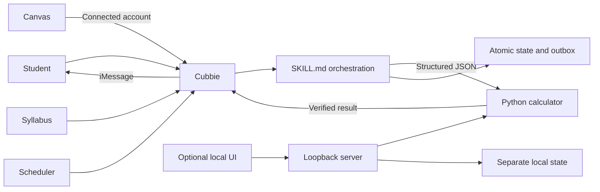
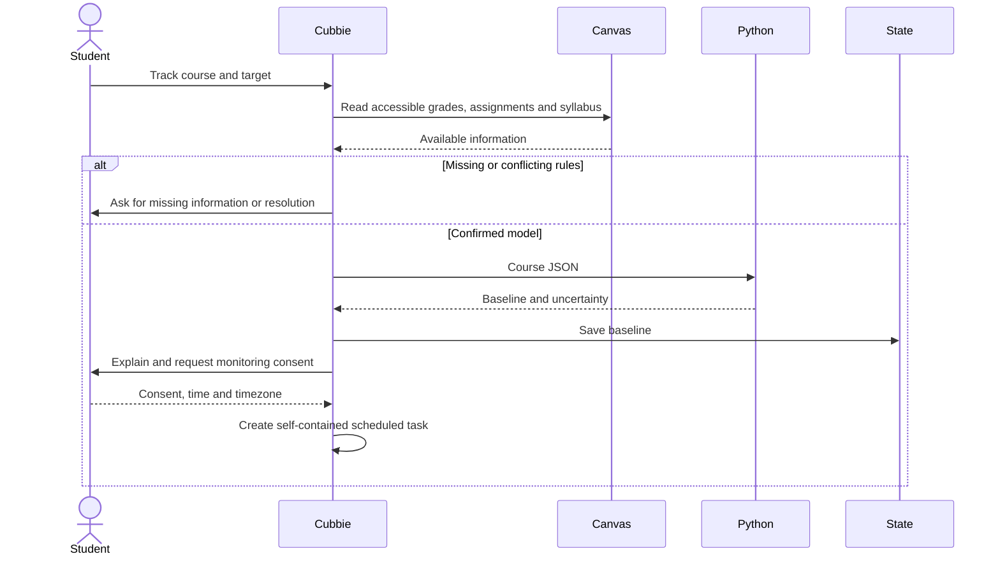
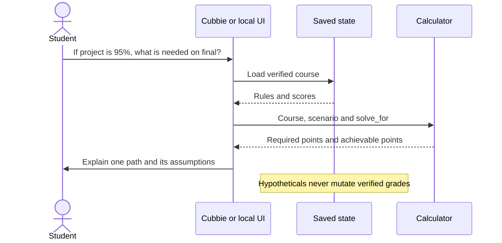
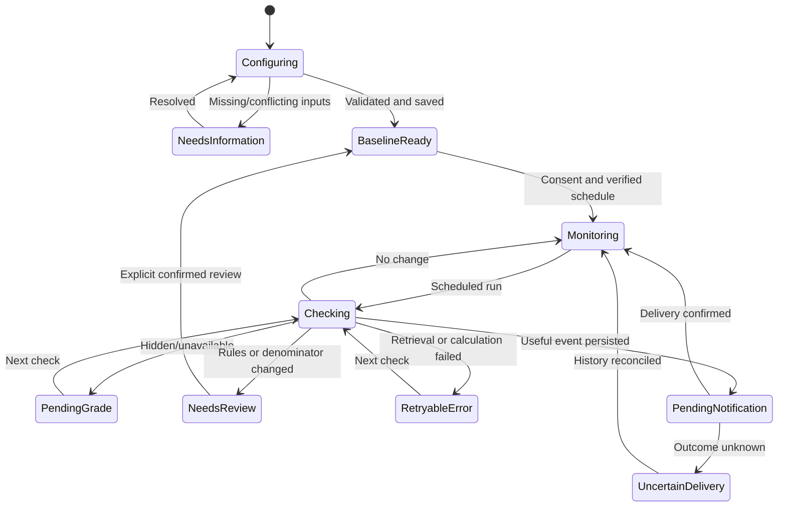

# GradePath architecture

## Scope and evidence

The standalone Cubbie Skill and optional local web companion share a deterministic
Python engine. The companion was explicitly requested after the architecture-only
brief; it is not needed to install or run Track 1. Cubbie retrieves and communicates;
Python calculates; per-student files persist. The LLM is not the arithmetic engine.

Design reference: [Cubbie hackathon](https://hackathon.cubbie.ai/), inspected October
24, 2026: Nunito, Shantell Sans, warm cream, blue actions, outlined pill buttons,
soft shapes and handwritten accents. The illustration is original CSS and text.

Platform evidence: [official capabilities](https://raw.githubusercontent.com/imaginix-inc/cubbie-hackathon-kit/main/skills/cubbie-skill-creator/references/cubbie-capabilities.md)
and [official kit](https://github.com/imaginix-inc/cubbie-hackathon-kit).
Documented: Canvas reads, scheduled check-ins, Python scripts, persistent HOME,
and repository-linked Agent Skills. Scripts cannot invoke Cubbie's abilities.
Skills describe abilities in prose rather than inventing tool names.

The user confirms connected Canvas access survives logout from their own browser.
The design separates that browser session from Cubbie's connection; revoked or
expired connections still require reconnection.

Unverified: exact Canvas grade fields, weights, maximum points, displayed totals,
hidden-grade behavior, statuses, syllabus coverage, stable IDs, scheduler invocation
reliability, monitoring limits, Gmail in scheduled runs, and structured-input size.
Incoming Gmail triggers remain unsupported. Automatic `SKILL_DATA_DIR` injection
is unverified; set it explicitly to a directory under documented persistent HOME.

## Component diagram and responsibility matrix



| Owner | Responsibility |
|---|---|
| Cubbie | Canvas connection, retrieval, syllabus, scheduling, messages |
| SKILL.md | Normalize inputs, verify provenance, obtain consent, interpret results |
| Python | Validate, calculate exact results, compare snapshots, manage state |
| Persistent state | Course, target, rules, snapshots, event revisions, delivery outbox |
| Local app | Manual/imported data, visual scenarios; no Canvas or messaging bridge |

## Setup sequence



## Scheduled check sequence

```mermaid
sequenceDiagram
  participant Schedule
  participant C as Cubbie
  participant Canvas
  participant S as State helper
  participant P as Calculator
  actor Student
  Schedule->>C: Invoke GradePath for saved course
  C->>Canvas: Read latest accessible data
  alt Retrieval fails
    C->>C: Keep prior state; retry next check
  else Data retrieved
    C->>S: Check normalized snapshot
    alt Rules changed
      S-->>C: needs_review, no replacement
      C->>Student: Ask to resolve changed rules
    else No grade change
      S-->>C: no_change or pending_grade
      C->>C: Quiet; reconcile older pending deliveries separately
    else New or revised grade
      S->>P: Recalculate
      P-->>S: Result and warnings
      S->>S: Persist snapshot, event and outbox atomically
      S-->>C: Useful pending notifications
      C->>Student: Concise consolidated update
      C->>S: Acknowledge confirmed delivery
    end
  end
```

## What-if sequence



## Schemas and mathematics

The final course JSON schema is `gradepath/references/course.schema.json`.
The input/result/state contract is `gradepath/references/input-contract.md`.
Unknown results are null. Calculation status: success, needs_information,
needs_review; invalid requests produce error without mutation.

One versioned `state.json` replaces three loosely coupled files. It contains course,
rules_hash, revision, events, notifications, last_successful_check, and optional
rule_reviews. Events have ID, assignment ID/name, before/after score, maximum points,
type, timestamp. Notifications embed event, calculation, status (pending/sent/uncertain)
and timestamps. Source references and rule provenance travel with the course.

Numbers are parsed from decimal representations into exact rational numbers.
Only JSON output/display uses floats. Score increments use exact ceiling.

**Points.** E earned, G graded possible, R remaining possible, T target fraction.
With complete denominator F=G+R: current=E/G; required=max(0,T×F−E);
remaining fraction=(T×F−E)/R; max=(E+R)/F; reachable iff max≥T.
G=0 yields null current. R=0 yields final grade and no remaining requirement.

**Weighted.** For category c, final denominator D_c=G_c+R_c.
Secured contribution B=Σw_c E_c/D_c. Remaining capacity K=Σw_c R_c/D_c.
Uniform future fraction x=(T−B)/K. This means the same percentage on each
remaining point in each category, not a raw points average across categories.
Current graded average is Σ(w_c E_c/G_c)/Σ(active weights), explicitly normalized.
Today's category contribution is not permanently earned when future work remains.

**Scenarios.** Add fixed hypothetical points to B; remove their points from K.
To solve a single assignment, fix every other remaining assignment. Convert the
required fraction to points and round up to the known increment. If this exceeds
the maximum, the scenario is impossible. Never invent score increments.

Only complete denominators allow exact maximum/reachability. Other completeness
states return conditional values. Unknown maximum points, hidden scores, or unsupported
policies suppress reliable projections. Ungraded is not zero; excused work is excluded.

## State machine and failure strategy



Partial retrieval merges by stable IDs, never deletes unseen work, and never infers
zeros. Disappearing scores remain historical and make output conditional. Changed
weights, category membership, point maxima, or excusal require review. Explicit
review archives the previous model and preserves events/outbox.
Monotonic event revisions distinguish 85→92→85; identical snapshots add no events.

Writes use an exclusive lock, same-directory temporary file, fsync and atomic replace.
Malformed state or lock contention fails closed. Inspect stale locks after a crash.
Retry retrieval or known failed delivery on the next scheduled run, not a tight loop.
Persist the outbox before delivery. Unknown outcomes are uncertain and require
history reconciliation; no undocumented exactly-once platform guarantee is claimed.
Consolidate stale pending events and use the latest calculation when notifying.

## Repository

```text
gradepath/SKILL.md
gradepath/scripts/calculate.py
gradepath/scripts/state.py
gradepath/references/course.schema.json
gradepath/references/input-contract.md
app.py
web/{index.html,style.css,app.js}
tests/test_gradepath.py
docs/architecture.md
README.md
```

The installable folder is `gradepath/`. Two scripts suffice: comparison belongs
inside the state transaction. The optional web server never runs inside Cubbie.

## Independently calculated test matrix

| Case | Expected |
|---|---|
| 720/800, remaining200, target92 | Need200 points; 100%; reachable |
| Same, target93 | Need210; impossible; max92% |
| HW30% at270/300; projects30% at85/100 + future95/100; final40%; target90 | Final90/100 |
| Same, target93 | Raw final97.5; whole-point minimum98 |
| Weighted baseline | Current87.5; secured39.75; max94.75; uniform remaining91.3636% |
| 92.4% of50, whole points | Raw46.2; require47 |
| Hidden / unknown maximum | needs_information, no exact maximum |
| Drop-lowest / conflicts | needs_review |
| Ungraded points final | Current90%, not72% |
| Explicit missing zero on final | Current72% |
| Partial denominator | Unconditional reachability/max null |
| Repeated identical snapshot | No additional event or notification |
| 85→92→85→92 | Three unique events |
| Partial assignment list | Preserve all prior work |
| Confirmed delivery | sent persists through duplicate check |
| Concurrent write | Second writer fails, state intact |

## Ten-hour live integration plan

| Hours | Work and completion gate |
|---|---|
| 0–1 | Publish/install Skill; verify actual invocation immediately |
| 1–2 | Inspect real Canvas fields, identify course, verify syllabus and target |
| 2–4 | Calculator fixtures, weighted/points edge cases, what-if |
| 4–5 | Real baseline; verify persistence across Cubbie runs |
| 5–6 | Real snapshot change and duplicate check |
| 6–7 | Consent, schedule, observe real autonomous invocation |
| 7–8 | Useful iMessage, outbox acknowledgment, delivery retry |
| 8–9 | Real connected-account failures; fix issues; freeze features |
| 9–10 | Regression, README, concise demo, Track 1 submission |

This is a plan, not a claim that live integration gates have passed.

## Consistent demo under 90 seconds

0–20s: weighted baseline, target90, current87.5, remaining91.36.
20–40s: revise Project1 from85 to80; uniform remaining becomes92.73.
40–60s: hypothetical Project2=95; final now requires91.875, rounded92/100.
60–75s: repeat snapshot; no new event.
75–90s: show real Cubbie message only after a verified scheduled run; otherwise
label it as a local demonstration. The original brief's claim of final90 for
target93 is inconsistent with its weighted example; the correct whole-point
requirement with Project1=85 and Project2=95 is98.

## Acceptance criteria

Local: calculator/state tests pass; app loads; target/score edits recalculate;
reload preserves changes; scenarios do not mutate scores; import/export works;
uncertainty is visible; Skill format validates; responsive/keyboard UI checked.

Still requiring live verification: public GitHub install, Cubbie invocation, real
course selection, verified target and rules, persistent state across runs, scheduled
check detecting a real grade change, duplicate silence, delivered iMessage,
conversational what-if, and hidden/unsupported-policy behavior. The local app does
not by itself satisfy these Track 1 platform gates.
